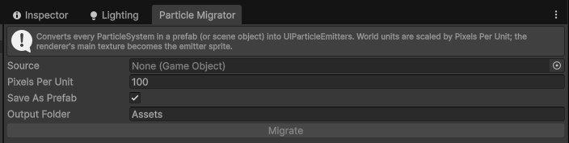

# UI Particle Engine

A custom particle engine for Unity uGUI, written from scratch. Particles are simulated on the CPU and pushed straight to the `CanvasRenderer` — **no Shuriken, no Canvas rebuilds, zero GC allocations per frame**.

[](https://unity.com)
[](#)
[](#-testing)
[](LICENSE)

## Unity 2022.3 compatibility fork

This fork adds Unity 2022.3 LTS package support to
[berkencami/ui-particle-engine](https://github.com/berkencami/ui-particle-engine),
based on upstream commit `6b22ce5cbe823269d9f337f8546e2cab0b2865a5`.
The optimized simulation and mesh-rendering implementation, assembly names,
serialized fields and existing asset GUIDs are preserved.

Install the package into an existing Unity 2022.3 project using the Git URL below.
The repository-root demo project remains authored in Unity 6; opening that project
in Unity 2022.3 is not the supported installation workflow.

The package declares its UGUI, Physics 2D and Particle System module dependencies.
TextMeshPro is optional for the engine. On Unity 2022.3, install TextMeshPro 3.x
to enable the sample assembly and its counter/benchmark examples. The sample
assembly also recognises TextMeshPro supplied by UGUI 2.x on Unity 6; Unity 6
execution is not revalidated by this port.

For setup, verification scope and limitations, see the
[package guide](Assets/UIParticleEngine/README.md#unity-20223-support).
The benchmark figures below are upstream Unity 6 measurements, not a performance
comparison or a performance guarantee for Unity 2022.3.

## 🎮 Demo

Everything lives in a single scene: `Assets/Scenes/SampleScene.unity` — a portrait mobile "reward screen" driving every engine feature at once.

| Coin reward (attractor) | Confetti (flipbook) | Fireworks (trails) |
| :---: | :---: | :---: |
|  |  |  |

| Sample | Shows off |
| --- | --- |
| `UIParticleCoinReward` | `Emit()` burst + `UIParticleAttractor` + arrival callback driving a TMP counter |
| `UIParticleConfettiDemo` | Texture sheet animation (3×3 debris flipbook, random start frame) |
| `UIParticleFireworkShow` | World-space simulation, per-shell color tinting, tapered ribbon trails |
| `UIParticleClickBurst` | Emitter teleporting to the pointer (heart bursts), world-space particles staying put |
| Falling stars (scene only) | Rect shape emission, prewarm, rotation over lifetime |

> **Note** — the demo art ships with the repository: a handful of particle sprites from [Cartoon FX Remaster FREE](https://assetstore.unity.com/packages/vfx/particles/cartoon-fx-remaster-free-109565) by Jean Moreno (in `Samples/Textures`) plus two simple UI sprites. The engine itself has **no dependencies** on any of it.

## 📝 Description

Rendering particles inside a uGUI canvas is awkward: `ParticleSystem` lives in world space and fights the canvas (sorting, masking, scaling), while naive `Graphic`-based solutions rebuild the canvas mesh every frame through `SetVerticesDirty`, allocating and re-batching constantly.

This engine takes a third path: a `UIParticleEmitter` is a regular `MaskableGraphic`, but it bypasses the uGUI rebuild pipeline entirely. Geometry is written into a persistent `NativeArray` with a compact 24-byte vertex layout and handed to the renderer via `CanvasRenderer.SetMesh` on double-buffered meshes — once per frame, only when something actually changed.

- ✅ Renders inside the canvas: sorts, masks and scales like any other UI element
- ✅ Familiar API: modules and playback controls mirror Unity's Shuriken `ParticleSystem`
- ✅ Zero per-frame GC allocations, verified by tests and profiling

## 📌 Key Features

- **Direct mesh push** — `CanvasRenderer.SetMesh` with double-buffered meshes; no `SetVerticesDirty`, no canvas rebuild, no per-frame allocation
- **Shuriken-style modules** — main, emission (rate over time / distance + bursts), shape (cone / circle / rect / point), velocity & limit velocity, color / size / rotation over lifetime, texture sheet animation (flipbook), trails
- **Trails** — per-particle ribbon trails with width & color curves, fixed zero-alloc ring buffers
- **UI Particle Attractor** — pulls particles into a UI target (the classic coin-to-wallet effect) with a per-particle arrival callback
- **World / Local simulation space** — world-space particles stay put while the emitter moves, and survive screen / Game-view resizes
- **Flipbook animation** — texture sheet playback with cycles, random start frame and a frame-over-time curve
- **Edit-mode preview** — play particles in the Scene view without entering Play mode
- **Deterministic seeding** — replayable effects via explicit random seeds
- **Curve/gradient LUT baking** — `AnimationCurve`/`Gradient` lookups are baked to small LUTs per mesh build, replacing hundreds of thousands of managed→native `Evaluate` calls
- **Shuriken-style playback API** — `Play` / `Pause` / `Stop(StopBehavior)` / `Clear` / `Emit(count)` / `Simulate` / `IsAlive`
- **Custom inspector** — boxed module editor styled after the built-in ParticleSystem inspector
- **Shuriken migrator** — `Tools ▸ UI Particle Engine ▸ Particle Migrator` converts existing `ParticleSystem` prefabs into `UIParticleEmitter` prefabs: modules mapped one-to-one, world units scaled to canvas pixels, material textures re-imported as sprites, and anything unsupported listed in a report

## ⚙ Installation

### Via Package Manager (UPM)

**Window ▸ Package Manager ▸ + ▸ Add package from git URL...**

```
https://github.com/niaoyue/ui-particle-engine.git?path=Assets/UIParticleEngine
```

Or add it to `Packages/manifest.json` directly:

```json
{
  "dependencies": {
    "com.berkencami.ui-particle-engine": "https://github.com/niaoyue/ui-particle-engine.git?path=Assets/UIParticleEngine"
  }
}
```

### Manual

The engine is a self-contained folder with its own asmdefs — copy `Assets/UIParticleEngine/Runtime` (and optionally `Editor`) into your project. There are no package dependencies; `Samples` additionally uses TextMeshPro.

Or clone the whole repository and open it as a Unity 6000.3+ project to explore the demo scene and tests.

## 🚀 Usage

Add a **UI Particle Emitter** (`UI/Effects/UI Particle Emitter`) to any `RectTransform` under a canvas, assign a sprite, press Play — or drive it from code:

```csharp
using UIParticleEngine;

var emitter = gameObject.AddComponent<UIParticleEmitter>();
emitter.Sprite = mySprite;

// Configure modules like Shuriken:
emitter.Main.StartLifetime = new RangeF(0.8f, 1.4f);
emitter.Main.StartSpeed    = new RangeF(200f, 400f);
emitter.Main.GravityModifier = 0.3f;
emitter.Main.SimulationSpace = UIParticleEmitter.SimulationSpace.World;

emitter.Shape.ShapeType = UIParticleEmitter.ShapeType.Cone;
emitter.Shape.Angle = 25f;

emitter.ColorOverLifetime.Enabled = true;
emitter.Trails.Enabled = true;

// Playback:
emitter.Play();
emitter.Emit(30);                                            // manual burst
emitter.Stop(UIParticleEmitter.StopBehavior.StopEmitting);   // let alive particles finish
```

### Attractor

```csharp
var attractor = walletIcon.AddComponent<UIParticleAttractor>();
attractor.Emitter = coinEmitter;
attractor.OnAttracted.AddListener(() => coins++);  // fires once per consumed particle
```

### Playback API

| Member | Behavior |
| --- | --- |
| `Play()` / `Pause()` | Start emission / freeze simulation (resumes from pause) |
| `Stop(StopBehavior)` | Stop emitting, optionally clearing alive particles |
| `Clear()` | Remove all particles immediately |
| `Emit(int count)` | Spawn particles now, ignoring emission rate |
| `Simulate(float dt)` | Step the simulation manually *(incremental — documented deviation from Shuriken)* |
| `IsAlive()` | Any particles still alive or emission pending |
| `ParticleCount`, `IsPlaying`, `IsPaused` | State queries |

## 🔁 Migrating from Shuriken

Already have `ParticleSystem` effects? **Tools ▸ UI Particle Engine ▸ Particle Migrator** converts a prefab (or scene object) into a ready-to-use `UIParticleEmitter` hierarchy:



- Every supported module is mapped one-to-one — main, emission + bursts, shape, velocity, drag, color/size/rotation over lifetime, texture sheet, trails
- World units are scaled to canvas pixels (`Pixels Per Unit`), radians to degrees, `MinMaxGradient` start colors to a two-color blend
- The renderer's main texture is re-imported as a Sprite and assigned to the emitter
- Anything Shuriken-only (noise, collision, sub-emitters, curves collapsed to ranges...) is listed in a migration report instead of failing silently

## 📊 Performance

Measured with the built-in stress probe (simulation step + full mesh build per frame, averaged over 120 frames; Unity 6000.3 editor, Windows desktop):

| Particles | Trails | Simulate / frame | Mesh build / frame | GC / frame |
| ---: | :---: | ---: | ---: | ---: |
| 500 | – | 0.013 ms | 0.19 ms | **0 B** |
| 2,000 | – | 0.050 ms | 0.71 ms | **0 B** |
| 8,000 | – | 0.198 ms | 2.73 ms | **0 B** |
| 500 | ✔ (12 pts) | 0.025 ms | 1.98 ms | **0 B** |
| 1,000 | ✔ (12 pts) | 0.050 ms | 3.97 ms | **0 B** |

Compared to the initial `SetVerticesDirty`-based implementation, the `SetMesh` path made frame cost **~2–2.5× cheaper** across the board.

### On device

Measured on a mid-range phone (Snapdragon 732G, Adreno 618, 1080×2400@60Hz), IL2CPP ARM64 development build, results printed by the on-device benchmark in the sample scene:

| Particles | Trails | Simulate / frame | Mesh build / frame | GC / frame |
| ---: | :---: | ---: | ---: | ---: |
| 500 | – | 0.002 ms | 0.08 ms | **0 B** |
| 2,000 | – | 0.011 ms | 0.23 ms | **0 B** |
| 8,000 | – | 0.041 ms | 0.99 ms | **0 B** |
| 500 | ✔ (12 pts) | 0.009 ms | 0.87 ms | **0 B** |
| 1,000 | ✔ (12 pts) | 0.019 ms | 1.86 ms | **0 B** |

IL2CPP comes out **faster than the Mono editor numbers** across the board, and a live sample with 8,000 on-screen particles renders at the panel's 60 Hz ceiling (avg 16.9 ms/frame, 59.3 fps) — the practical mobile limit is GPU overdraw, not the simulation.

## 🛠 How It Works

- **Bypassing the rebuild pipeline** — `UIParticleEmitter` never dirties the canvas for geometry. A hidden updater (`[DefaultExecutionOrder(32000)]`) advances all registered emitters in `Update` and flushes dirty meshes once in `LateUpdate` via `CanvasRenderer.SetMesh`.
- **Compact vertices** — a 24-byte vertex (`Vector3` position, `Color32`, `Vector2` uv) in a persistent `NativeArray`, with prebuilt index buffers that auto-switch from 16-bit to 32-bit past 65k vertices.
- **Double buffering** — two meshes flip at most once per frame so the renderer never reads a mesh mid-write.
- **Zero-GC simulation** — particles live in a plain struct array with swap-remove; trails use slot-indexed ring buffers; scratch buffers are grow-only statics.
- **LUT baking** — every mesh build bakes active curves/gradients into 64-entry LUTs, turning per-particle `Evaluate` calls into array reads.
- **Culling-aware** — mesh flushes are skipped while the `CanvasRenderer` is culled (e.g. under a `RectMask2D`).

## 🧪 Testing

36 EditMode tests cover the RNG, emission timing (bursts, cycles, probability, start delay), lifetime, playback state machine, prewarm, seeded determinism, the attractor, trails + flipbook smoke tests, the Shuriken migrator's module mapping, and warmed allocation checks:

`Window ▸ General ▸ Test Runner ▸ EditMode ▸ Run All`

Four PlayMode tests cover automatic playback, disable/re-enable, pause/resume,
unscaled time, and rendered pixels with CanvasGroup, Mask and RectMask2D.
They also run in a Windows standalone Test Player. See the
[package guide](Assets/UIParticleEngine/README.md#unity-20223-support) for the
verified environment and test installation instructions.

## 📁 Project Structure

```
Assets/UIParticleEngine/
├─ Runtime/            UIParticleEmitter, UIParticleAttractor, UIParticleUpdater, RangeF
├─ Editor/             Shuriken-style inspector, RangeF drawer, edit-mode preview, particle migrator
├─ Samples/            Coin reward, confetti, fireworks, click burst + debug probe + demo textures
└─ Tests/             EditMode and PlayMode regression suites
```
